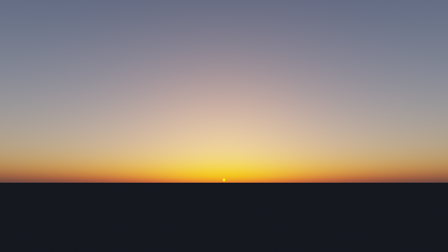
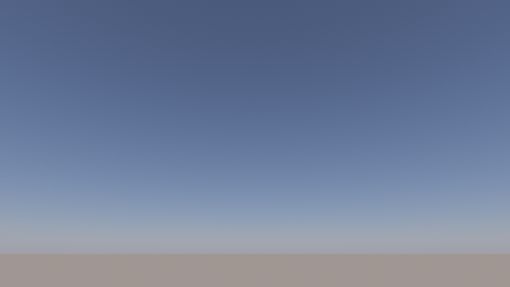
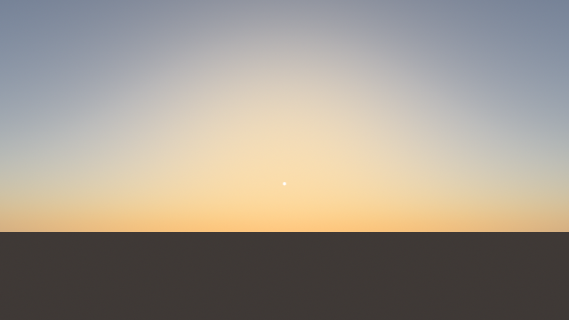
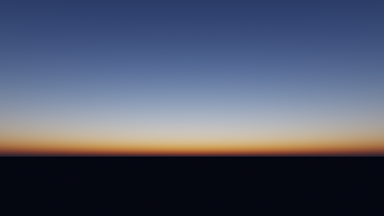
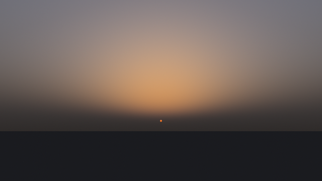
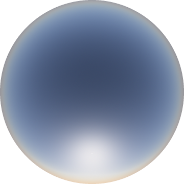
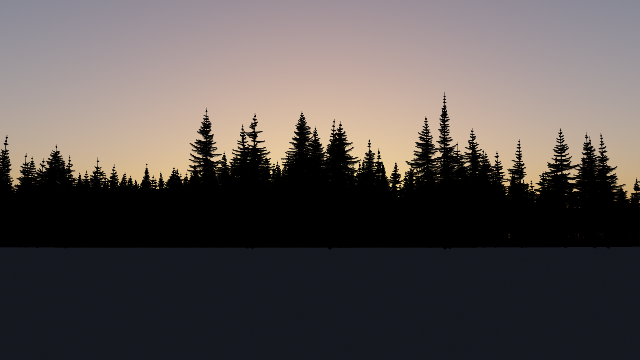

# pixel-skies

A physically based sky renderer that writes PNG images of clear skies for
any sun position, from noon blue through sunsets to deep twilight. Light is
traced spectrally through Rayleigh-scattering air, Mie-scattering aerosol
and ozone, multiple scattering included, and baked into lookup tables so a
frame renders in a fraction of a second. Plain Rust, no dependencies: the
PNG encoder, threading and colour science are all in the crate.

| | |
|---|---|
|  |  |
| Noon, looking away from the sun | Golden hour, sun at 8° |
|  |  |
| Belt of Venus over Earth's shadow, sun at −2° | Dusk, sun at −6° |
|  |  |
| Hazy, humid air, sun at 3° | All-sky fisheye, sun at 30° |

## Running

Bake an atmosphere once (about 7 s on an M1), then render it from any sun
position (about 150 ms for 640×360):

    cargo build --release
    ./target/release/pixel-skies bake
    ./target/release/pixel-skies render --elevation 1 --out out/sunset.png

The bake depends only on the air, so try a few:

    ./target/release/pixel-skies bake --aerosol 0.25 --humidity 0.9 \
        --out out/humid.bin
    ./target/release/pixel-skies render --sky out/humid.bin --elevation 3

Bake options:

| option | default | |
|---|---|---|
| `--aerosol` | 0.05 | dry aerosol optical depth at 550 nm |
| `--humidity` | 0.5 | relative humidity, 0 to just below 1 |
| `--ozone` | 300 | ozone column in Dobson units |
| `--albedo` | 0.2 | ground reflectance |
| `--out` | out/sky.bin | baked tables, about 28 MB |

Render options:

| option | default | |
|---|---|---|
| `--sky` | out/sky.bin | baked tables to read |
| `--elevation` | 10 | sun elevation in degrees, down to −20 |
| `--azimuth` | 180 | sun azimuth in degrees clockwise from north |
| `--camera` | perspective | or `fisheye` for an all-sky dome |
| `--yaw` | sun azimuth | perspective view direction |
| `--pitch` | 12 | perspective view elevation |
| `--fov` | 80 | horizontal field of view |
| `--width`, `--height` | 1280, 720 | image size |
| `--exposure` | 0 | compensation in stops |
| `--out` | out/sky.png | image to write |

## Trees

A foreground treeline of procedural spruces renders separately, as black
silhouettes on transparent pixels, through the same camera as the sky so
the two line up when stacked:

    ./target/release/pixel-skies trees --pitch 6 --fov 60 --out out/trees.png
    ./target/release/pixel-skies render --elevation 0.5 --pitch 6 --fov 60
    convert out/sky.png out/trees.png -composite out/treeline.png

| option | default | |
|---|---|---|
| `--seed` | 1 | which forest |
| `--distance` | 150 | meters to the forest edge |
| `--density` | 0.06 | trees per square meter |
| `--yaw`, `--pitch`, `--fov` | 180, 12, 80 | as for `render` |
| `--width`, `--height` | 1280, 720 | image size |
| `--out` | out/trees.png | image to write |

Each spruce is a few thousand tapered capsules in meters: a leaning trunk
and whorls of branches, longest some way down the crown and shortening
to a spire at the top. Upper branches reach up, lower ones sag and curl
their tips up again, hung with shoots that droop more the lower they sit.
Every tree draws its own slenderness, droop, fullness and lopsidedness,
and loses the odd whorl, branch and shoot. The forest edge wavers, trees
grow in clumps of similar height with young trees beneath and a few old
ones above, edge trees keep branches to the ground while shaded ones keep
only dead stubs, and a few are snags with broken tops.

Limbs project through the camera and cover pixels by their distance
field, combining as if independent, so a distant crown of countless
sub-pixel shoots still adds up to a solid shape.

## Video

A ten second sunset over the treeline, a few hundred times faster than
life, renders through ffmpeg to `out/sunset.mp4` in about seven minutes:

    ./video.sh

The sun sinks along its path, which near the horizon tilts from vertical
by the latitude, so it slides north as it sets. Meanwhile the camera
trucks slowly sideways and the nearer trees shift against the farther
ones. The script pipes raw RGBA frames from the `video` binary into
ffmpeg and passes extra options on to it, as in `./video.sh --seed 3`:

| option | default | |
|---|---|---|
| `--sky` | out/sky.bin | baked tables to read |
| `--from`, `--to` | 8, −4 | sun elevation at the start and end |
| `--azimuth` | 270 | where the sun sets, also the view direction |
| `--latitude` | 60 | of the observer, tilting the sun's path |
| `--travel` | 8 | meters the camera moves to the right |
| `--pitch`, `--fov` | 12, 60 | as for `render` |
| `--seed`, `--distance`, `--density` | 1, 150, 0.06 | as for `trees` |

## How it works

The observer stands on the ground, so the sky they see depends on three
angles only: view elevation, sun elevation, and the azimuth between them.
Baking fills a 128 × 96 × 64 table over those angles, building it up in
three steps:

1. **Transmittance** to space from any altitude and direction, tabulated in
   Bruneton's parametrization.
2. **Multiple scattering** in Hillaire's (2020) approximation: light that
   has bounced twice or more is nearly isotropic, so its sum over all
   orders is a geometric series per altitude and sun angle, ground bounce
   included.
3. **Sky radiance** from ray marching every table direction, using the two
   tables above for sunlight and multiply scattered light at each sample.
   Earth's shadow, the Belt of Venus and reddened twilight fall out of
   whether sunlight reaches each sample, and through how much air.

All of it runs on 48 wavelengths from 360 to 830 nm against the measured
solar spectrum and ozone cross section, then collapses to CIE XYZ. That
step is exact because everything after it is linear in radiance. As in
Bruneton and Neyret (2008), single scattering is stored without its phase
function, which each pixel then applies analytically. That keeps the
sharp forward glow of aerosol around the sun crisp on a coarse table.

Humidity enters through the aerosol: following Hänel, particles take up
water and scatter (1 − RH)^−0.4 times more strongly, without absorbing
more. The larger droplets scatter more greyly and more forward, which
turns clean blue skies milky and sunsets dull orange.

Rendering looks the table up per pixel, adds the limb-darkened solar disk
and a ground lit by sun and sky, and exposes for the mean sky radiance,
partially adapting so twilight still reads as dusk. An ACES-style filmic
curve and dithered sRGB encoding finish the image.

## References

- E. Bruneton, F. Neyret. *Precomputed Atmospheric Scattering.* 2008.
- E. Bruneton. *A Qualitative and Quantitative Evaluation of 8 Clear Sky
  Models.* 2017.
- S. Hillaire. *A Scalable and Production Ready Sky and Atmosphere
  Rendering Technique.* 2020.
- C. Wyman, P.-P. Sloan, P. Shirley. *Simple Analytic Approximations to
  the CIE XYZ Color Matching Functions.* 2013.
- G. Hänel. *The Properties of Atmospheric Aerosol Particles as Functions
  of the Relative Humidity.* 1976.
